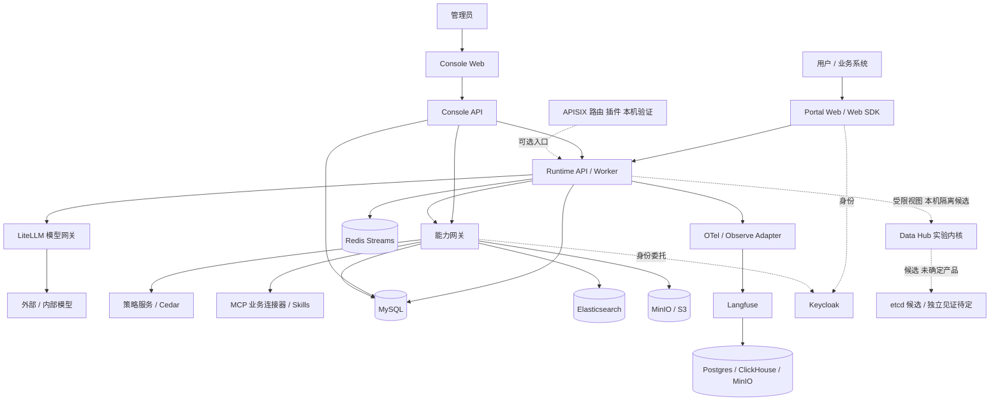

# 当前物理架构、技术选型与复杂度盘点

盘点时间：2026-10-27。依据仓库、Compose／Helm 配置和实施计划；这是**组件与设计盘点，不是实时运行实例清单**。本机代码、隔离测试、部署模板、生产运行和候选设计分别标示，不推断正式部署。S9 外部出口未完成，D47／S10.7 生产部署延期；S12／S13／S14 均不等于完整出口。

## 1. 总体判断

当前方案技术复杂度**偏高且仍在增长**。原因是平台同时覆盖 Agent 执行、模型／能力网关、动态权限、执行安全、分布式恢复、观测评测和控制面，而不是单一聊天应用；近期 S12 主体写锁、S14 权威／见证等又增加身份、状态和故障恢复协议。部分增长是治理要求带来的合理成本，但实际首批业务和交付边界尚未冻结，存在在业务闭环之前提前建设大量通用基础设施的风险。尚无经过一致度量的历史数据，无法准确声称复杂度增长百分比或所有组件已投产。

## 2. 物理视图：代码与配置能支持的完整形态

以下为**逻辑依赖映射到潜在进程／服务的目标视图**，不表示所有方框在同一环境同时启动；一个方框也不必等同独立机器。Data Hub 与独立见证不应画成已部署组件。

各线表示功能依赖或候选路径，不是已核验的实时网络拓扑。入口代理、应用服务、基础设施可以按环境合并或分离；故障域与容量尚未完成生产设计。

## 3. 自研应用与运行时组件

| 组件 | 技术选型 | 职责 | 现状与复杂度 |
|---|---|---|---|
| Portal Web | Vue 3、Vite、TypeScript、Pinia | Agent 选择、对话和卡片 | S13 同 Run 本机闭环；多轮、附件、正式发布未完成 |
| Console Web | Vue 3、Vite、TypeScript、Pinia | 配置、发布、运营、节点、调试 | S11／S12 本机能力较多，真实身份／运营口径仍待验收 |
| Web / Python SDK | Lit Web Component、TypeScript；Python | 对话、事件、写锁与回执 | 随主体锁和恢复协议复杂度上升；SDK 完整发布待办 |
| Runtime API / Worker | Python、FastAPI、SQLAlchemy、Redis Streams、SSE | Run 状态机、模型调用、工具执行、审批与恢复 | 本机实现较完整；事件、租约、幂等、身份和跨节点恢复均增加状态成本 |
| Harness | Claude SDK、LiteLLM 兼容调用、stdio 适配器 | 接入不同 Agent 执行内核 | 提升适配能力，也引入协议探针、进程池与版本兼容 |
| Console API | Python、FastAPI、MySQL / SQLite | Agent 配置、发布、目录、节点控制 | 与 Runtime、网关、评测有交叉依赖；目录元数据不等于真实 IdP 账号管理 |
| Capability Gateway | Python、FastAPI、MySQL、ES 可选检索 | 能力目录、发现、授权代理、Token Exchange、MCP | 用户与服务身份、OBO、act、连接器是主要边界复杂度 |
| Policy | Python FastAPI、Cedar sidecar；本机 baseline 可选 | 资源授权、禁止规则 | 正式 read_data permit 尚未启用；能力级与数据级授权不可混用 |
| Observe Adapter | Python、FastAPI | 观测数据及反馈对接 Langfuse | 可信反馈需要额外来源证明、回执和对账协议 |
| MCP / Skills | MCP 连接器、Skill 包、脚本执行与审查 | 对接业务工具 | 已有模板和工单样例，真实业务集成／生产验收不等同测试替身 |
| Data Hub | Python、SQLite 受限视图实验内核 | 行过滤、列遮盖、限行及隔离模型 | 尚未作为正式服务接入；S14.1 未完成；真实数据权限／可信权威未定 |

## 4. 基础设施和第三方选型

| 类别 | 组件 | 角色 | 现状及注意点 |
|---|---|---|---|
| 身份 | Keycloak / OIDC / JWKS / Token Exchange | 用户、服务身份与委托 | 仓库配置与本机测试存在；正式 IdP 映射、生产密钥及网络边界未验收 |
| 主存储 | MySQL 8.4 配置；本地测试 SQLite | Runtime、Console、网关状态 | 同一 MySQL 可容纳多服务逻辑表，不等于每服务独立实例；真实库备份／迁移仍有门禁 |
| 消息／协调 | Redis Streams / PubSub | Run 队列、租约相关协作、缓存等 | 引入消费者组、重放、去重和故障恢复 |
| 对象存储 | MinIO / S3 接口 | Skill 包、对象及 Langfuse 等 | 不代表 S14 签名下载已实现或已授权 |
| 检索／知识 | Elasticsearch、FastEmbed 可选 | 能力发现及知识检索 | 模型缓存、ES 运维和索引一致性均有成本；不能直接删而不评估搜索能力 |
| 模型接入 | LiteLLM Proxy + 自用 PostgreSQL | 模型别名、路由与预算 | 外部模型供应商与实际模型授权按环境决定 |
| 可观测／评测 | OpenTelemetry、Langfuse Web/Worker、PostgreSQL、ClickHouse、MinIO | Trace、评测与反馈 | 功能重要，但 Langfuse 不是单个轻量进程；Trace 不是 Run／财务事实 |
| 机密管理 | Vault／Vault Agent 模板 | 密钥注入 | 本机 dev 模式是内存态；生产密钥治理未验收 |
| 入口／路由 | APISIX 与项目插件 | 按节点组与既有 Run 路由 | 真实本机 APISIX 路由曾验证；未声称生产部署 |
| 容器／交付 | Docker Compose；Helm／Argo CD 草稿 | 本机运行、未来部署 | D47 延期，不能把 Helm 模板或 Argo CD 配置当作已启用生产 |
| 沙箱 | Docker 隔离已有本机测试；gVisor 为计划 | 脚本／工具隔离 | S14.3 gVisor、Helm 默认启用未完成；不是已部署保障 |
| 独立权威／见证 | etcd 3.5.21 单节点隔离试验；3.6 为候选；见证产品未定 | 未来清单／策略高水位、新鲜性和防回滚 | 只做模型和 3.5 单节点验证；快照恢复因 tmpfs 空间不足失败。不得计入已上线依赖，真实见证／信任根未定 |

Compose 主文件列出 15 个服务条目，其中包含一次性初始化任务、可选 observe profile、LiteLLM／Langfuse 自带数据库；不等于运行时必须有 15 台服务器或当前已有 15 个运行容器。平台服务构建配置另列 5 个自研服务；两份 Compose 范围不同，不能简单把条目数相加。

## 5. 复杂度主要来自哪里

1. **组件数量与供应链**：主数据库、消息、检索、对象存储、身份、模型代理、评测及其附属数据库，各自有版本、升级、备份与故障模式。完整环境部署比主对话链路重得多。
2. **身份与授权链**：浏览器 → Runtime → 网关 → OBO／act → MCP／Data Hub，同时涉及 Cedar、租户、Agent 与数据范围；安全要求合理，但接口和排错链较长。
3. **一致性和恢复**：Run 状态／租约、写前登记、主体未决锁、回执 ACK、指令回执及 S14 高水位需要明确的状态转换；这是当前研发时间的主要消耗点之一。
4. **多层治理在业务成熟前展开**：S9 Skill 执行、S10 节点路由、S12 可信反馈和 S14 独立见证均有真实用途，但其正式授权或业务环境未就绪；若同时深化，可能持续积累并行未闭环事项。
5. **多套运行形态**：本机演示、替身测试、真实依赖、节点组及未来 Kubernetes／gVisor 并存。若没有明确的运行配置矩阵，容易混淆“测试通过”和“生产可用”。

## 6. 推荐的减复杂度方向（仅建议，未实施）

1. 先定义一个**首批业务场景与最小可体验运行配置**：单 Runtime、Portal／Console、必要身份和模型接入；按真实使用决定是否启用其他服务。先测清现有各路径的硬依赖，再确定可以安全关闭或合并的项。
2. 将 S14 正式权威／独立见证列为**高敏数据接入条件**，在缺少真实经营数据接入需求时维持隔离模型和明确门禁，不继续扩大产品选型或运维设施。若首批场景必需，则先由数据和安全责任人确认边界、RTO／RPO、预算与故障域。
3. 对 ES 检索、Langfuse 及其附属存储、分布式节点／APISIX 等分别做“当前必需、可暂缓、不能替代的安全条件”评估；不直接撤销授权、审计、租户隔离、写结果未知冻结等安全语义。
4. 收敛演示与开发配置：清楚区分本机模拟、真实单节点和生产目标；明确最少启动项、可选项、启动／停止与验收命令。避免把替身测试、旧全仓结果或真实服务只读兼容当生产验收。
5. 建立业务价值与技术债清单：每批只推进一个可体验能力和其必要安全闭环；外部身份、生产网络、真实评测、可信评分与独立见证等由责任人分批确认，不以架构完备为唯一目标。

建议下一步先做**首批业务场景和最小运行依赖清单**，逐个验证组件是否为该场景的启动必需、业务必需或生产门禁，再决定是否简化。此建议不包含删除代码、缩减安全控制或部署操作。

## 7. 主要依据

- 根目录 `README.md` 的分层与选型；`deploy/compose-dev/docker-compose.yml` 和 `docker-compose.services.yml` 的服务定义；`apps/*/package.json` 和各服务 `pyproject.toml`。
- `docs/plan/实施计划.md` 的 S9～S14 状态；`docs/decisions/2026-10-27-S14-etcd真实单节点验证报告.md` 的真实 3.5.21 单节点与恢复失败证据；S13 本机报告。
- 本文件不读取实时服务数据、不操作原库、不构成完整安全、性能或生产架构审计。
